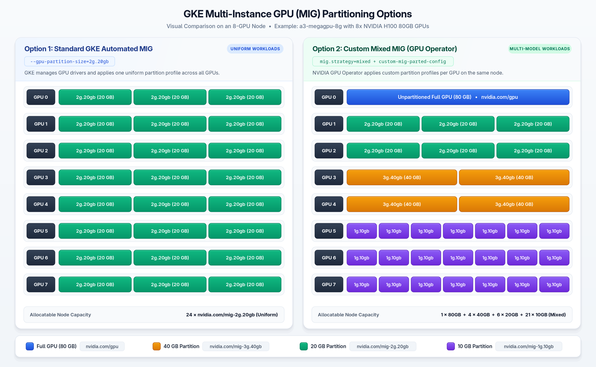

# Configure Custom GPU Partitions on a GKE Node Pool

Multi-Instance GPU (MIG) divides one physical NVIDIA GPU into multiple isolated GPU partitions. Each MIG partition has dedicated compute cores, memory bandwidth, and cache. Google Kubernetes Engine (GKE) supports two methods to configure MIG partitions on GPU nodes. This guide shows how to configure custom mixed MIG partitions on a single GKE node. You can apply this method to `a3-mega`, `a3-ultra`, `g4`, `a2`, and `a4` machine series.

---

## Choose Between Standard GKE MIG and Custom Mixed MIG

GKE provides two approaches for GPU partitioning based on your workload requirements:

### Option 1: Standard GKE Automated MIG

Standard GKE MIG uses the `--gpu-partition-size` flag during node pool creation. GKE automatically installs GPU drivers, configures the NVIDIA device plugin, and partitions every GPU. GKE applies one uniform MIG partition size across all GPUs in the node pool. This option fits uniform workloads that require identical GPU partition sizes and automated management.

### Option 2: Custom Mixed MIG with the NVIDIA GPU Operator

Some workloads run multiple models with different GPU memory requirements on the same node. For these workloads, you can install the NVIDIA GPU Operator with `mig.strategy=mixed`. This strategy reads a custom MIG configuration from a Kubernetes `ConfigMap`.

With custom mixed MIG, you define the exact partition layout for each GPU:

- Assign different MIG partition sizes to different GPUs on the same node.
- Combine multiple MIG partition sizes inside a single physical GPU.
- Keep specific GPUs unpartitioned for large Pods alongside partitioned GPUs on the same node.



---

## Supported GKE GPU Machine Series

Custom mixed MIG works on any GKE machine series with MIG-capable NVIDIA GPUs:

| Machine Series | Machine Type Example | GPU Model | GKE Accelerator Type | Example MIG Partition Sizes |
| :--- | :--- | :--- | :--- | :--- |
| **A3 Mega** | `a3-megagpu-8g` | NVIDIA H100 (80GB) | `nvidia-h100-mega-80gb` | `1g.10gb`, `2g.20gb`, `3g.40gb`, `7g.80gb` |
| **A3 Ultra** | `a3-ultragpu-8g` | NVIDIA H200 (141GB) | `nvidia-h200-141gb` | `1g.18gb`, `2g.35gb`, `3g.71gb`, `7g.141gb` |
| **G4 Standard** | `g4-standard-48` | NVIDIA RTX PRO 6000 (96GB) | `nvidia-rtx-pro-6000` | `1g.24gb`, `2g.48gb`, `4g.96gb` |
| **A2 Ultra** | `a2-ultragpu-8g` | NVIDIA A100 (80GB) | `nvidia-a100-80gb` | `1g.10gb`, `2g.20gb`, `3g.40gb`, `7g.80gb` |
| **A4 High** | `a4-highgpu-8g` | NVIDIA B200 (180GB) | `nvidia-b200` | `1g.23gb`, `2g.45gb`, `3g.90gb`, `7g.180gb` |

To let the NVIDIA GPU Operator manage custom MIG partitions on GKE, follow five settings:

1. Set `--gpu-driver-version=disabled` so the NVIDIA GPU Operator manages the GPU drivers.
2. Set the node label `gke-no-default-nvidia-gpu-device-plugin=true` so the NVIDIA GPU Operator manages the device plugin.
3. Select the `UBUNTU_CONTAINERD` node image. Ubuntu provides the writable filesystem paths that the NVIDIA GPU Operator requires.
4. Install the NVIDIA GPU Operator with `mig.strategy=mixed`.
5. Define your custom MIG configuration in a Kubernetes `ConfigMap`.

---

## Example Target GPU Partition Layout

The steps in this guide use an `a3-megagpu-8g` Spot node as the primary example. Step 2 and Step 3 also provide configuration options for `a3-ultra` and `g4` nodes.

The `a3-megagpu-8g` example divides eight NVIDIA H100 80GB GPUs into four resource groups:

| GPU Index | Partition Configuration | Partitions per GPU | Kubernetes Resource Name | Total Allocatable Count |
| :--- | :--- | :--- | :--- | :--- |
| GPU 0 | Unpartitioned (80GB memory) | 1 | `nvidia.com/gpu` | 1 |
| GPU 1, GPU 2 | `2g.20gb` (20GB memory) | 3 | `nvidia.com/mig-2g.20gb` | 6 |
| GPU 3, GPU 4 | `3g.40gb` (40GB memory) | 2 | `nvidia.com/mig-3g.40gb` | 4 |
| GPU 5, GPU 6, GPU 7 | `1g.10gb` (10GB memory) | 7 | `nvidia.com/mig-1g.10gb` | 21 |

---

## Prerequisites

Complete these prerequisites before you start:

1. Install the Google Cloud CLI (`gcloud`).
2. Install `kubectl`.
3. Install `helm`.
4. Authenticate your Google Cloud account:
   ```bash
   gcloud auth login
   ```
5. Authenticate your Application Default Credentials for `gke-gcloud-auth-plugin`:
   ```bash
   gcloud auth application-default login
   ```
6. Set your target Google Cloud project in the `PROJECT_ID` variable:
   ```bash
   PROJECT_ID=<YOUR_PROJECT_ID>
   gcloud config set project ${PROJECT_ID}
   ```

---

## Step 1: Create the VPC Network and GKE Cluster

A dedicated VPC network isolates your cluster network resources inside shared Google Cloud projects.

1. Create a VPC network with automatic subnets:
   ```bash
   gcloud compute networks create gpu-mig-vpc --subnet-mode=auto
   ```

2. Create a firewall rule to allow internal traffic across the VPC network:
   ```bash
   gcloud compute firewall-rules create gpu-mig-vpc-allow-internal \
     --network=gpu-mig-vpc \
     --allow=tcp,udp,icmp \
     --source-ranges=10.128.0.0/9
   ```

3. Set your target region and zone in the `REGION` and `ZONE` variables:
   ```bash
   REGION=<YOUR_REGION>
   ZONE=<YOUR_ZONE>
   ```

4. Create a GKE cluster with one CPU node for system controllers:
   ```bash
   gcloud container clusters create gpu-mig-cluster \
     --zone=${ZONE} \
     --network=gpu-mig-vpc \
     --machine-type=e2-standard-4 \
     --num-nodes=1
   ```

5. Get the authentication credentials for your cluster:
   ```bash
   gcloud container clusters get-credentials gpu-mig-cluster --zone=${ZONE}
   ```

---

## Step 2: Create the GPU Node Pool

Select the command for your target machine series (`a3-mega`, `a3-ultra`, or `g4`). Each command uses the `--spot` flag to create a Spot node and optimize cost.

> [!NOTE]
> The `g4` machine series uses `hyperdisk-balanced` boot disks by default. Verify that your target region (`${REGION}`) has available `HDB_TOTAL_GB` quota and Spot GPU capacity.

### Option A: `a3-mega` (8x NVIDIA H100 80GB)

Create an `a3-megagpu-8g` node pool:

```bash
gcloud container node-pools create a3-mega-spot-pool \
  --cluster=gpu-mig-cluster \
  --zone=${ZONE} \
  --machine-type=a3-megagpu-8g \
  --accelerator=type=nvidia-h100-mega-80gb,count=8,gpu-driver-version=disabled \
  --image-type=UBUNTU_CONTAINERD \
  --spot \
  --node-labels="gke-no-default-nvidia-gpu-device-plugin=true,mig-node=custom-mig" \
  --num-nodes=1
```

### Option B: `a3-ultra` (8x NVIDIA H200 141GB)

Create an `a3-ultragpu-8g` node pool:

```bash
gcloud container node-pools create a3-ultra-spot-pool \
  --cluster=gpu-mig-cluster \
  --zone=${ZONE} \
  --machine-type=a3-ultragpu-8g \
  --accelerator=type=nvidia-h200-141gb,count=8,gpu-driver-version=disabled \
  --image-type=UBUNTU_CONTAINERD \
  --spot \
  --node-labels="gke-no-default-nvidia-gpu-device-plugin=true,mig-node=custom-mig" \
  --num-nodes=1
```

### Option C: `g4` (1x NVIDIA RTX PRO 6000 96GB)

Create a `g4-standard-48` node pool:

```bash
gcloud container node-pools create g4-spot-pool \
  --cluster=gpu-mig-cluster \
  --zone=${ZONE} \
  --machine-type=g4-standard-48 \
  --accelerator=type=nvidia-rtx-pro-6000,count=1,gpu-driver-version=disabled \
  --image-type=UBUNTU_CONTAINERD \
  --spot \
  --node-labels="gke-no-default-nvidia-gpu-device-plugin=true,mig-node=custom-mig" \
  --num-nodes=1
```

> [!NOTE]
> Omit the `--gpu-partition-size` flag when you use custom mixed MIG. That flag activates standard GKE automated MIG with a uniform partition size.

---

## Step 3: Create the MIG Configuration ConfigMap

The NVIDIA GPU Operator reads the MIG configuration from a Kubernetes `ConfigMap`. This `ConfigMap` defines custom layouts for `a3-mega`, `a3-ultra`, and `g4` nodes.

1. Create the `gpu-operator` namespace:
   ```bash
   kubectl create namespace gpu-operator
   ```

2. Create the `custom-mig-parted-config` `ConfigMap` in the `gpu-operator` namespace:
   ```bash
   cat <<EOF | kubectl apply -f -
   apiVersion: v1
   kind: ConfigMap
   metadata:
     name: custom-mig-parted-config
     namespace: gpu-operator
   data:
     config.yaml: |
       version: v1
       mig-configs:
         # Profile for a3-megagpu-8g (8x NVIDIA H100 80GB)
         a3-mega-layout:
           - devices: [0]
             mig-enabled: false
           - devices: [1, 2]
             mig-enabled: true
             mig-devices:
               "2g.20gb": 3
           - devices: [3, 4]
             mig-enabled: true
             mig-devices:
               "3g.40gb": 2
           - devices: [5, 6, 7]
             mig-enabled: true
             mig-devices:
               "1g.10gb": 7

         # Profile for a3-ultragpu-8g (8x NVIDIA H200 141GB)
         a3-ultra-layout:
           - devices: [0]
             mig-enabled: false
           - devices: [1, 2]
             mig-enabled: true
             mig-devices:
               "2g.35gb": 3
           - devices: [3, 4]
             mig-enabled: true
             mig-devices:
               "3g.71gb": 2
           - devices: [5, 6, 7]
             mig-enabled: true
             mig-devices:
               "1g.18gb": 7

         # Profile for g4-standard-48 (1x NVIDIA RTX PRO 6000 96GB)
         g4-layout:
           - devices: [0]
             mig-enabled: true
             mig-devices:
               "2g.48gb": 1
               "1g.24gb": 2
   EOF
   ```

---

## Step 4: Install the NVIDIA GPU Operator

GKE uses `ResourceQuota` objects to control critical priority classes in standard namespaces. The NVIDIA GPU Operator requires the `system-node-critical` and `system-cluster-critical` priority classes.

1. Create a `ResourceQuota` in the `gpu-operator` namespace to allow critical priority Pods:
   ```bash
   cat <<EOF | kubectl apply -f -
   apiVersion: v1
   kind: ResourceQuota
   metadata:
     name: gcp-critical-pods
     namespace: gpu-operator
   spec:
     hard:
       pods: "100"
     scopeSelector:
       matchExpressions:
       - operator: In
         scopeName: PriorityClass
         values:
         - system-node-critical
         - system-cluster-critical
   EOF
   ```

2. Add the NVIDIA Helm repository:
   ```bash
   helm repo add nvidia https://helm.ngc.nvidia.com/nvidia
   ```

3. Update your local Helm chart repository cache:
   ```bash
   helm repo update
   ```

4. Set the privileged Pod Security Admission label on the `gpu-operator` namespace:
   ```bash
   kubectl label --overwrite ns gpu-operator pod-security.kubernetes.io/enforce=privileged
   ```

5. Install the NVIDIA GPU Operator with Helm:
   ```bash
   helm upgrade --install gpu-operator nvidia/gpu-operator \
     --namespace gpu-operator \
     --set mig.strategy=mixed \
     --set migManager.enabled=true \
     --set migManager.config.name=custom-mig-parted-config \
     --set migManager.config.default=all-disabled \
     --set migManager.with_reboot=true
   ```

The `migManager.config.default=all-disabled` setting leaves GPUs unpartitioned on nodes that do not have a MIG label.

> [!NOTE]
> On GKE 1.33 and later, configure the container toolkit to read the runtime configuration from a file. Set this environment variable in the `ClusterPolicy` resource:
> ```yaml
> toolkit:
>   env:
>     - name: RUNTIME_CONFIG_SOURCE
>       value: "file"
> ```

---

## Step 5: Apply the MIG Configuration to the GPU Node

1. Wait until all Pods in the `gpu-operator` namespace reach the `Running` or `Completed` state:
   ```bash
   kubectl get pods -n gpu-operator
   ```

2. Save the GPU node name to the `NODE_NAME` variable:
   ```bash
   NODE_NAME=$(kubectl get nodes -l mig-node=custom-mig -o jsonpath='{.items[0].metadata.name}')
   ```

3. Apply the MIG configuration label for your machine series to the GPU node:
   - For `a3-mega`, apply the `a3-mega-layout` label:
     ```bash
     kubectl label nodes ${NODE_NAME} nvidia.com/mig.config=a3-mega-layout --overwrite
     ```
   - For `a3-ultra`, apply the `a3-ultra-layout` label:
     ```bash
     kubectl label nodes ${NODE_NAME} nvidia.com/mig.config=a3-ultra-layout --overwrite
     ```
   - For `g4`, apply the `g4-layout` label:
     ```bash
     kubectl label nodes ${NODE_NAME} nvidia.com/mig.config=g4-layout --overwrite
     ```

The `nvidia-mig-manager` DaemonSet detects this label, partitions the GPUs, and restarts the device plugin Pod.

4. Wait roughly 45 seconds and verify that the node label `nvidia.com/mig.config.state` equals `success`:
   ```bash
   kubectl get node ${NODE_NAME} -o jsonpath='{.metadata.labels.nvidia\.com/mig\.config\.state}{"\n"}'
   ```

---

## Step 6: Verify Allocatable GPU Resources

1. Verify the allocatable GPU resources on the node:
   ```bash
   kubectl describe node ${NODE_NAME} | grep -A 15 "Allocatable:"
   ```

2. Verify that the output matches your selected layout:
   - Expected output for `a3-mega` (`a3-mega-layout`):
     ```text
     Allocatable:
       nvidia.com/gpu: 1
       nvidia.com/mig-3g.40gb: 4
       nvidia.com/mig-2g.20gb: 6
       nvidia.com/mig-1g.10gb: 21
     ```
   - Expected output for `g4` (`g4-layout`):
     ```text
     Allocatable:
       nvidia.com/gpu:          0
       nvidia.com/mig-1g.24gb:  2
       nvidia.com/mig-2g.48gb:  1
     ```

---

## Step 7: Create Test Pods for Each Partition Size

GKE automatically adds the `nvidia.com/gpu=present:NoSchedule` taint to GPU nodes. The GKE admission controller automatically adds the matching toleration to Pods that request `nvidia.com/gpu`. For custom `nvidia.com/mig-*` resources, include the `nvidia.com/gpu` toleration directly in your Pod specification.

### Option A: Test Pods for `a3-mega` (`a3-mega-layout`)

Create four test Pods to test each GPU partition size on the `a3-mega` node:

```bash
cat <<EOF | kubectl apply -f -
apiVersion: v1
kind: Pod
metadata:
  name: test-pod-full-gpu
spec:
  tolerations:
  - key: "nvidia.com/gpu"
    operator: "Exists"
    effect: "NoSchedule"
  containers:
  - name: cuda
    image: nvidia/cuda:12.2.0-base-ubuntu22.04
    command: ["sh", "-c", "nvidia-smi -L && sleep 600"]
    resources:
      limits:
        nvidia.com/gpu: "1"
---
apiVersion: v1
kind: Pod
metadata:
  name: test-pod-40gb-mig
spec:
  tolerations:
  - key: "nvidia.com/gpu"
    operator: "Exists"
    effect: "NoSchedule"
  containers:
  - name: cuda
    image: nvidia/cuda:12.2.0-base-ubuntu22.04
    command: ["sh", "-c", "nvidia-smi -L && sleep 600"]
    resources:
      limits:
        nvidia.com/mig-3g.40gb: "1"
---
apiVersion: v1
kind: Pod
metadata:
  name: test-pod-20gb-mig
spec:
  tolerations:
  - key: "nvidia.com/gpu"
    operator: "Exists"
    effect: "NoSchedule"
  containers:
  - name: cuda
    image: nvidia/cuda:12.2.0-base-ubuntu22.04
    command: ["sh", "-c", "nvidia-smi -L && sleep 600"]
    resources:
      limits:
        nvidia.com/mig-2g.20gb: "1"
---
apiVersion: v1
kind: Pod
metadata:
  name: test-pod-10gb-mig
spec:
  tolerations:
  - key: "nvidia.com/gpu"
    operator: "Exists"
    effect: "NoSchedule"
  containers:
  - name: cuda
    image: nvidia/cuda:12.2.0-base-ubuntu22.04
    command: ["sh", "-c", "nvidia-smi -L && sleep 600"]
    resources:
      limits:
        nvidia.com/mig-1g.10gb: "1"
EOF
```

### Option B: Test Pods for `g4` (`g4-layout`)

Create three test Pods to use the one 48GB partition and both 24GB partitions on the `g4` node:

```bash
cat <<EOF | kubectl apply -f -
apiVersion: v1
kind: Pod
metadata:
  name: test-pod-48gb-mig
spec:
  tolerations:
  - key: "nvidia.com/gpu"
    operator: "Exists"
    effect: "NoSchedule"
  containers:
  - name: cuda
    image: nvidia/cuda:12.2.0-base-ubuntu22.04
    command: ["sh", "-c", "nvidia-smi -L && sleep 600"]
    resources:
      limits:
        nvidia.com/mig-2g.48gb: "1"
---
apiVersion: v1
kind: Pod
metadata:
  name: test-pod-24gb-mig-1
spec:
  tolerations:
  - key: "nvidia.com/gpu"
    operator: "Exists"
    effect: "NoSchedule"
  containers:
  - name: cuda
    image: nvidia/cuda:12.2.0-base-ubuntu22.04
    command: ["sh", "-c", "nvidia-smi -L && sleep 600"]
    resources:
      limits:
        nvidia.com/mig-1g.24gb: "1"
---
apiVersion: v1
kind: Pod
metadata:
  name: test-pod-24gb-mig-2
spec:
  tolerations:
  - key: "nvidia.com/gpu"
    operator: "Exists"
    effect: "NoSchedule"
  containers:
  - name: cuda
    image: nvidia/cuda:12.2.0-base-ubuntu22.04
    command: ["sh", "-c", "nvidia-smi -L && sleep 600"]
    resources:
      limits:
        nvidia.com/mig-1g.24gb: "1"
EOF
```

---

## Step 8: Verify GPU Memory in Each Pod

Hardware isolation dedicates the allocated GPU memory and compute cores to each Pod. Run the standard `nvidia-smi` command inside each container to view the `MIG devices` table.

### Option A: Verify `a3-mega` Pods

1. Verify the 40GB MIG partition in `test-pod-40gb-mig`:
   ```bash
   kubectl exec test-pod-40gb-mig -- nvidia-smi
   ```

2. Verify the 20GB MIG partition in `test-pod-20gb-mig`:
   ```bash
   kubectl exec test-pod-20gb-mig -- nvidia-smi
   ```

3. Verify the 10GB MIG partition in `test-pod-10gb-mig`:
   ```bash
   kubectl exec test-pod-10gb-mig -- nvidia-smi
   ```

4. Verify the 80GB unpartitioned GPU in `test-pod-full-gpu`:
   ```bash
   kubectl exec test-pod-full-gpu -- nvidia-smi
   ```

Compare your output against these expected values for `a3-mega`:

- `test-pod-full-gpu` shows `81559 MiB` of memory on one unpartitioned 80GB GPU.
- `test-pod-40gb-mig` shows `44MiB / 40448MiB` of memory and 60 SMs.
- `test-pod-20gb-mig` shows `29MiB / 20096MiB` of memory and 32 SMs.
- `test-pod-10gb-mig` shows `15MiB / 9984MiB` of memory and 16 SMs.

### Option B: Verify `g4` Pods

1. Verify the 48GB MIG partition in `test-pod-48gb-mig`:
   ```bash
   kubectl exec test-pod-48gb-mig -- nvidia-smi
   ```

2. Verify the first 24GB MIG partition in `test-pod-24gb-mig-1`:
   ```bash
   kubectl exec test-pod-24gb-mig-1 -- nvidia-smi
   ```

3. Verify the second 24GB MIG partition in `test-pod-24gb-mig-2`:
   ```bash
   kubectl exec test-pod-24gb-mig-2 -- nvidia-smi
   ```

Compare your output against these expected values for `g4`:

- `test-pod-48gb-mig` shows `128MiB / 48512MiB` of memory and 94 SMs (`GI ID: 1`).
- `test-pod-24gb-mig-1` shows `64MiB / 24192MiB` of memory and 46 SMs (`GI ID: 5` or `6`).
- `test-pod-24gb-mig-2` shows `64MiB / 24192MiB` of memory and 46 SMs (`GI ID: 5` or `6`).

---

## Step 9: Delete the Resources

Deleting the cluster and network resources after testing stops billing.

1. Delete the GKE cluster:
   ```bash
   gcloud container clusters delete gpu-mig-cluster --zone=${ZONE} --quiet
   ```

2. Delete the firewall rule:
   ```bash
   gcloud compute firewall-rules delete gpu-mig-vpc-allow-internal --quiet
   ```

3. Delete the VPC network:
   ```bash
   gcloud compute networks delete gpu-mig-vpc --quiet
   ```
